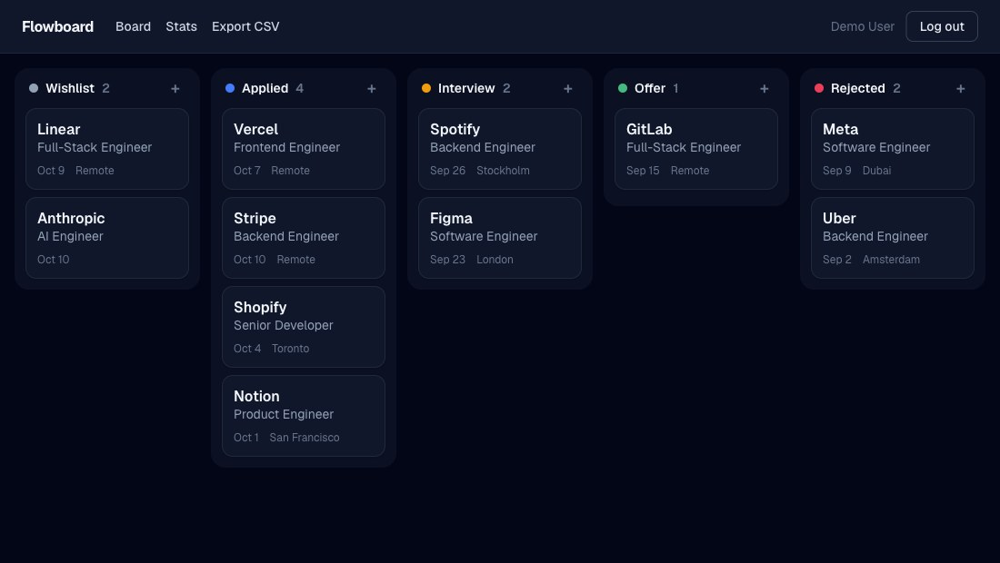
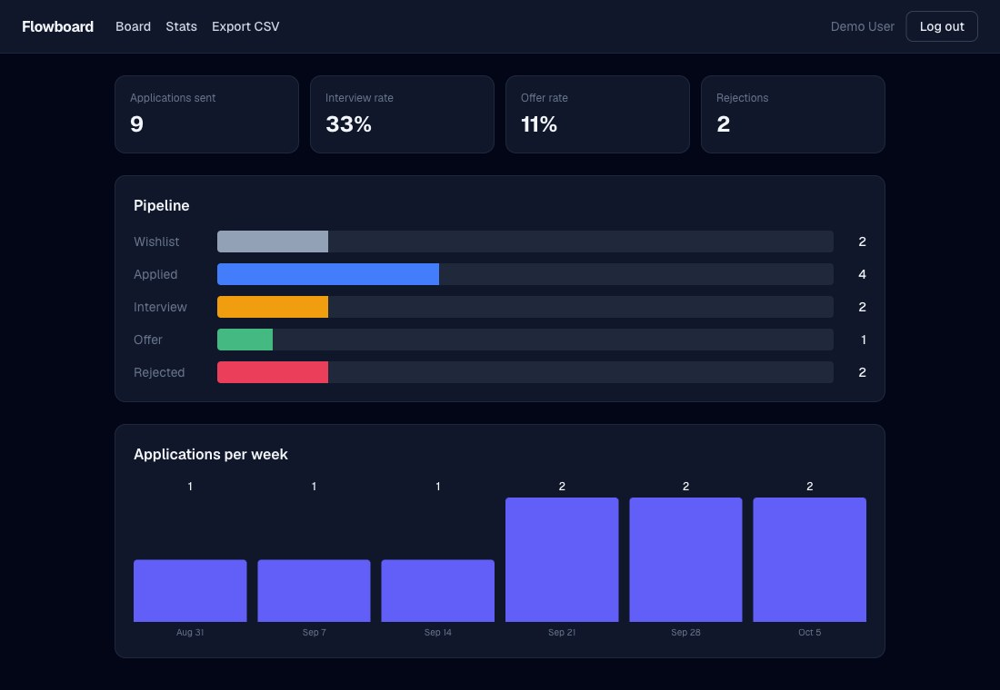

# Flowboard - Job Application Tracker

A kanban board for your job search. Drag applications through **Wishlist -> Applied -> Interview -> Offer -> Rejected**, see your conversion funnel, and export everything to CSV. Built with **Next.js (App Router, server-rendered)**, **Prisma** and **PostgreSQL**.

| | |
|---|---|
| Live demo | https://flowboard-app-eight.vercel.app (click **Try the live demo**: no sign-up, you get a private sandbox with sample data) |





## Features

- **Drag and drop** with touch support (dnd-kit), optimistic updates via React `useOptimistic`, order persisted with fractional positions so a move is a single-row write
- **Server-rendered** pages: the board and stats are rendered on the server from the database, mutations are **Server Actions** with Zod validation
- **Auth without a framework:** bcrypt password hashing, signed JWT in an `httpOnly` cookie (jose), a Data Access Layer (`requireUser`) that every page and action goes through, ownership checks on every write
- **Stats** computed in SQL: response/interview/offer rates, pipeline funnel and applications per week
- **CSV export** from a streaming route handler, with RFC 4180 escaping (unit tested)
- **Demo sandbox:** every "Try the demo" visitor gets their own throwaway user, so visitors never see each other's data
- Responsive, dark mode follows the system theme

## Tech stack

| Layer | Tools |
|---|---|
| Framework | Next.js 16 (App Router, Server Components, Server Actions, Route Handlers), React 19, TypeScript |
| Styling | Tailwind CSS 4 |
| Data | Prisma 7 + PostgreSQL (`@prisma/adapter-pg`) |
| Validation / auth | Zod, bcryptjs, jose |
| Tests / CI | Vitest, ESLint, GitHub Actions (Postgres service) |
| Hosting | Vercel + Neon |

## Run locally

```bash
docker compose up -d                # Postgres on :5435
cp .env.example .env
npm install
npx prisma migrate deploy
npm run dev                         # http://localhost:3100 (or 3000)
```

```bash
npm test        # unit tests (ordering + CSV)
npm run lint
npm run build   # prisma generate + migrate deploy + next build
```

## Design notes

- **Why fractional positions?** Reordering by index would rewrite every card in a column. Storing a `Float` position and inserting between neighbours (`(before + after) / 2`) keeps a move to one `UPDATE`. A column would need thousands of reorders in the same spot before floats run out of precision; a periodic rebalance would be the next step.
- **Why not Auth.js?** The app only needs email + password, so a small, explicit session layer (about 40 lines) keeps the security model easy to read and audit.

## License

MIT
